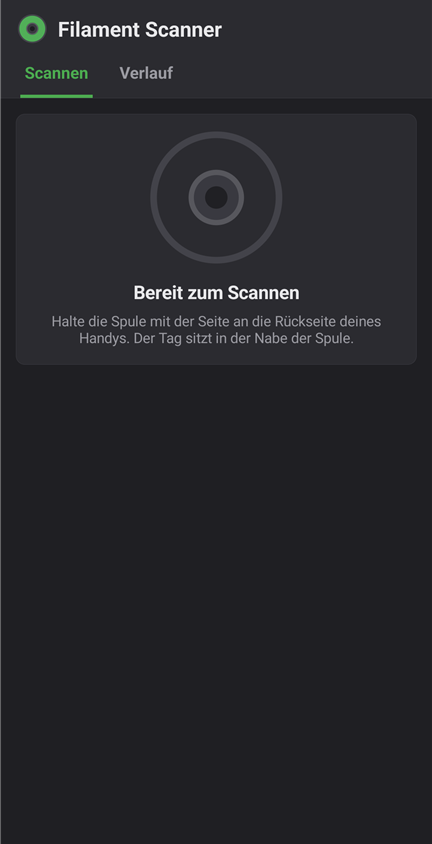
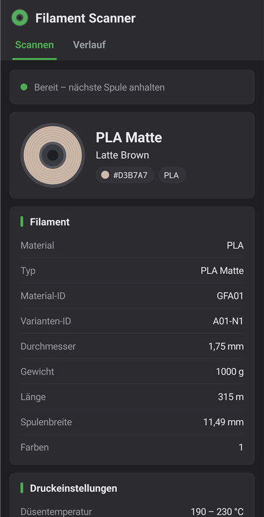
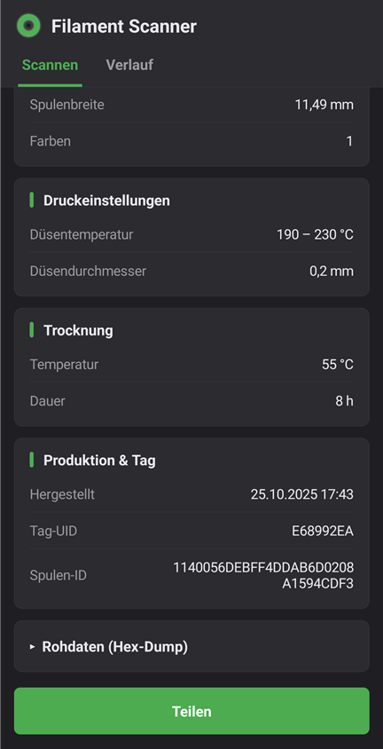

# Bambu Filament Scanner

Android-App (ab Android 8), die die NFC-Tags (MIFARE Classic 1K) von Bambu-Lab-Spulen liest und anzeigt.

<p>
  
  
  
</p>

## Funktionen

- Liest Material, Typ, Farbe (mit Bambu-Farbname), Durchmesser, Gewicht, Länge, Temperaturen, Trocknung und Produktionsdatum
- Verlauf der gescannten Spulen, lokal auf dem Gerät
- Teilen als Text inklusive Hex-Dump
- Dunkles Design im Stil von Bambu Studio

## Installieren

1. Die neueste `BambuFilamentScanner-*.apk` unter [Releases](../../releases/latest) herunterladen.
2. Antippen und installieren. Android fragt einmalig, ob die App (Browser oder Dateimanager) **unbekannte Apps installieren** darf, das erlauben.
3. Falls Play Protect warnt: **Trotzdem installieren**. Die App kommt nicht aus dem Play Store, deshalb kennt Google sie nicht.

Tipp: Bricht die Installation aus der Google-App „Dateien“ ohne Meldung ab, die APK mit einem anderen Dateimanager oder direkt aus der Download-Liste des Browsers öffnen.

### Voraussetzungen

- Android 8.0 oder neuer
- NFC mit **MIFARE-Classic**-Unterstützung (NXP-Chip). Die Bambu-Tags sind MIFARE Classic 1K.
  - Funktioniert meist: Google Pixel, Xiaomi und viele weitere
  - Oft **nicht**: viele Samsung-Geräte. Die App zeigt dann einen entsprechenden Hinweis, lesen ist leider nicht möglich.
- Gelesen werden nur originale Bambu-Lab-Tags. Beschreiben von Tags ist nicht vorgesehen.

## Bauen

Benötigt nur die Toolchain unter `%USERPROFILE%\.bambu-toolchain` (JDK 17, Android build-tools 34, Plattform android-34), kein Gradle und kein Android Studio.

```powershell
.\build.ps1                       # -> BambuFilamentScanner.apk
.\build.ps1 -VersionCode 2 -VersionName 1.1
```

`keystore\bambu-scanner.jks` nicht löschen: Updates müssen mit demselben Schlüssel signiert sein, sonst muss die App vorher deinstalliert werden.

## Aufbau

| Datei | Inhalt |
|---|---|
| `src/.../BambuTag.java` | HKDF-Schlüsselableitung aus der UID, Parsing der Blöcke |
| `src/.../TagReader.java` | MIFARE-Classic-Auslesen (alle 16 Sektoren) |
| `src/.../MainActivity.java` | UI (Scannen / Verlauf / Details) |
| `src/.../SpoolView.java` | Spulen-Grafik |
| `src/.../History.java` | Lokaler Verlauf |
| `src/.../ColorNames.java` | Farbnamen-Tabelle |

Tag-Format: https://github.com/Bambu-Research-Group/RFID-Tag-Guide

## Lizenz

MIT, siehe [LICENSE](LICENSE). Kein offizielles Produkt von Bambu Lab.
